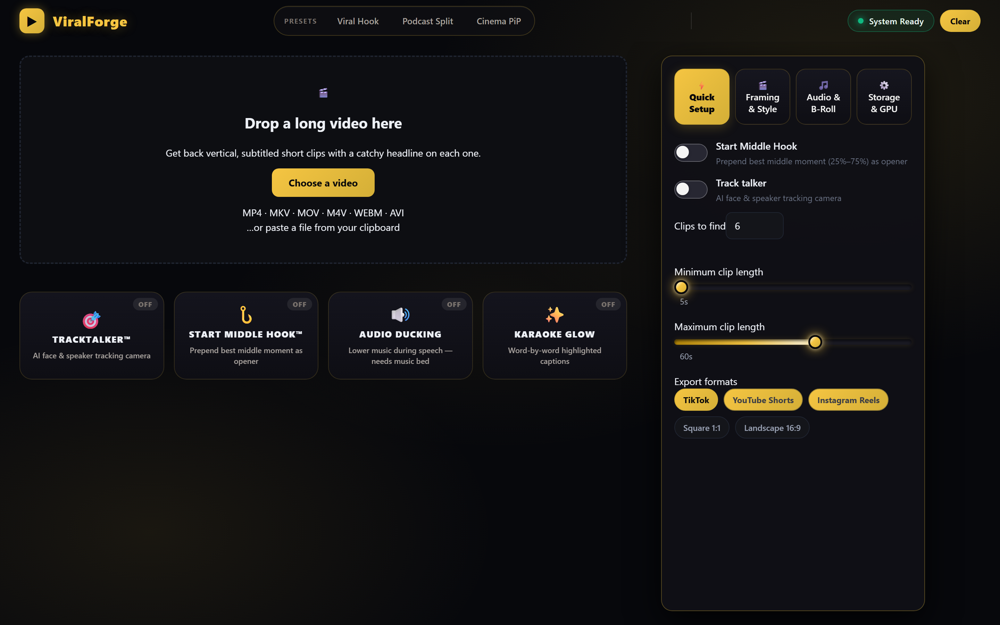
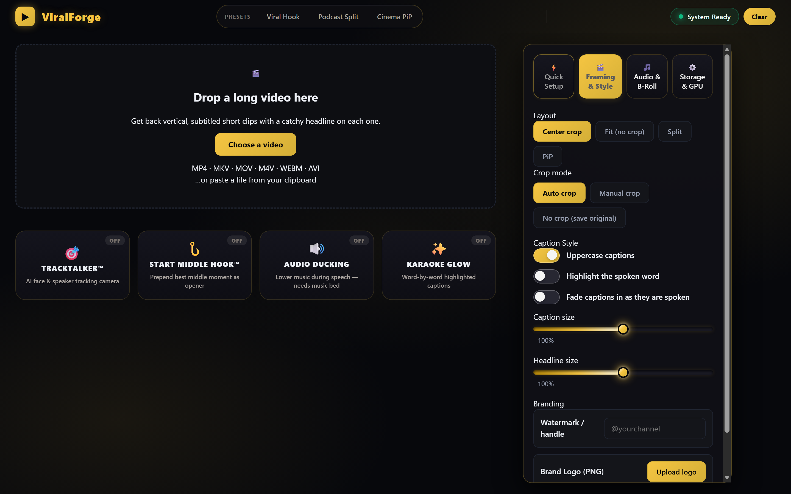
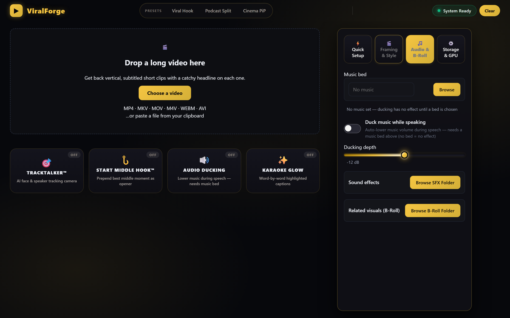
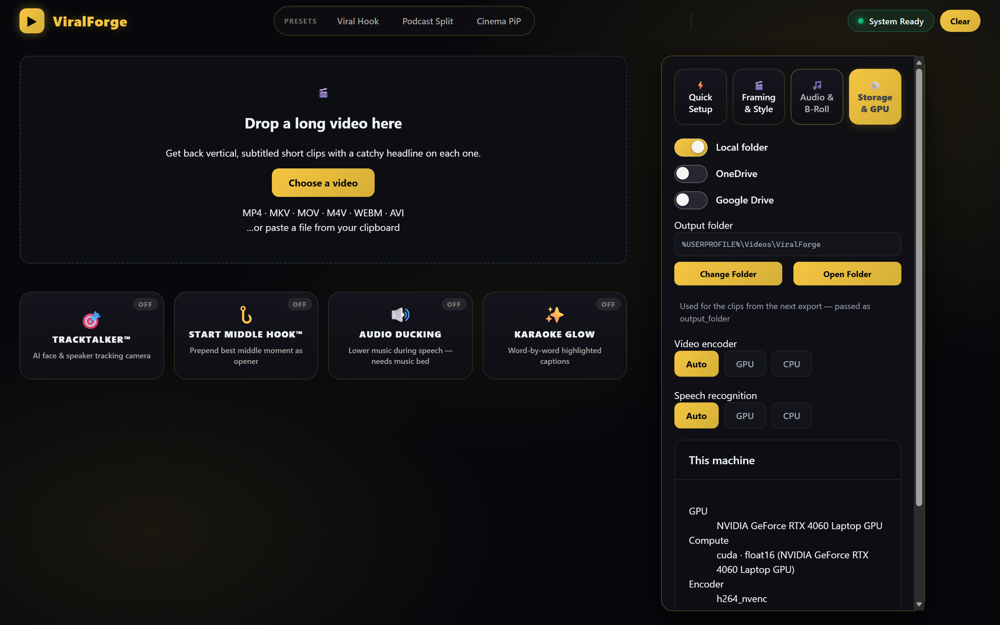

<div align="center">

# ⚡ VIRALFORGE

### *Turn Long-Form Videos into High-Retention Vertical Shorts — 100% Locally with AI*

[](../../releases/latest)
[-111111?style=for-the-badge&logo=windows&logoColor=D4AF37)](#)
[](#)
[](#)
[](#)

<br/>

<h2>🎬 Drop a Long Video → Get Viral Subtitled 9:16 Clips in Minutes</h2>

<p><sub><b>No subscriptions • No watermarks • No upload limits • Works offline on GPU or CPU</b></sub></p>

</div>

<div align="center">
  
</div>

## 📸 Studio Interface Tour

| **⚡ Quick Setup** | **🎨 Framing & Style** |
| :---: | :---: |
|  |  |
| **🎵 Audio & B-Roll** | **⚙️ Storage & GPU** |
|  |  |
## ViralForge vs. the Cloud

```diff
- $29–$99/month per creator
- Upload your raw footage to someone else's servers
- 10–30 minute queues and surprise limits
- Watermarks, throttling, and forced plans
- Re-rendering means waiting online again

+ $0/month — runs on your PC
+ Videos never leave your machine
+ Instant local re-renders from the inspector
+ No watermark, no account, no paywall
+ NVIDIA, AMD, Intel, or plain CPU
```

> [!TIP]
> **One-click download:** [Grab `ViralForge-Release.zip` from GitHub Releases](../../releases/latest) — a standalone Windows build with FFmpeg and the offline Whisper model bundled.

> [!IMPORTANT]
> **Friend install — 3 steps:**
> 1. Download **`ViralForge-Release.zip`** from **Releases**
> 2. Right-click → **Extract All…**
> 3. Double-click **`ViralForge.exe`** — first launch prepares the local environment and the bundled offline model in about 2 minutes.

## The 4 Signature Boosters

<table>
  <tr><th width="50%">🎯 TrackTalker™</th><th width="50%">🪝 Start Middle Hook™</th></tr>
  <tr>
    <td><b>YuNet ONNX AI Camera</b><br>Tracks 24 face/speaker points and keeps the active talker dead-center in the 9:16 crop — even when the camera isn't perfect.</td>
    <td><b>Automatic Cold Open</b><br>Finds the strongest climax moment in the 25%–75% range and prepends it as a 3-second hook before the clip starts.</td>
  </tr>
  <tr><th>🔊 Smart Audio Ducking</th><th>✨ Karaoke Glow</th></tr>
  <tr>
    <td><b>Music that gets out of the way</b><br>Detects speech and ducks background music by roughly <b>−12 dB</b>, so captions and dialogue stay intelligible.</td>
    <td><b>Word-by-word captions</b><br>Active-word highlighting, banner headlines, RTL Arabic support, and multilingual caption styling.</td>
  </tr>
</table>

## What's Inside the Studio

| Studio Tab | What you get |
|---|---|
| **⚡ Quick Setup** | Viral Hook / Podcast Split / Cinema PiP presets · 1–20 clips · duration sliders · TikTok, Shorts, Reels, Square 1:1, Landscape 16:9 |
| **🎨 Framing & Style** | Center crop · Fit (no crop) · Split · PiP · Manual crop · custom watermark · PNG brand logo · progress bar |
| **🎵 Audio & B-Roll** | Music beds · SFX folders · automatic B-Roll overlays · ducking depth control |
| **⚙️ Storage & GPU** | NVENC → AMF → QSV → MediaFoundation → CPU `libx264` · local/OneDrive/Google Drive · zero-bloat ephemeral cache · in-app re-render inspector |

## Quick Start

### For friend and creators

1. Download **`ViralForge-Release.zip`**.
2. Extract anywhere.
3. Double-click **`ViralForge.exe`**.

The first launch prepares the local venv and verifies that local dependencies are present. No Node.js, Python install, or account setup is required for the release build.

### For developers

```bash
git clone https://github.com/xShifox/ViralForge.git
cd ViralForge

python -m pip install -r requirements.txt
cd web
npm install
npm run build
cd ..

python -m clipforge --open
```

> [!NOTE]
> The `bin/ffmpeg.exe` and `bin/ffprobe.exe` files are **not tracked in git** because they exceed GitHub’s comfort zone. The standalone release `.zip` includes them.

## Settings & Portability

ViralForge never hard-codes your machine. Output defaults to:

```text
%USERPROFILE%\Videos\ViralForge
```

The default ASR model is **`tiny`**, the bundled offline model. `large-v3` is selectable for environments with more VRAM and is downloaded on demand.

## Project Layout

<table>
<tr><td><code>clipforge/</code></td><td>Python backend, ASR, scoring, render, API, job manager</td></tr>
<tr><td><code>web/src/</code></td><td>React frontend — Obsidian gold UI</td></tr>
<tr><td><code>web/dist/</code></td><td>Built frontend served by the backend</td></tr>
<tr><td><code>bin/</code></td><td>Bundled FFmpeg binaries (release only, not in git)</td></tr>
<tr><td><code>data/models/</code></td><td>Local Whisper model cache</td></tr>
<tr><td><code>scripts/</code></td><td>QA & release helpers</td></tr>
</table>

## Privacy

ViralForge is local-first.

- No account required
- No cloud upload
- No telemetry by default
- No watermark forced into output
- Deleting the export job wipes the upload and workspace

## Changelog

See **[RELEASE_NOTES.md](RELEASE_NOTES.md)** for the full v1.0.0 release notes.

## Download

[](../../releases/latest)

<div align="center">

**ViralForge — Your footage. Your PC. Your audience.**

</div>
