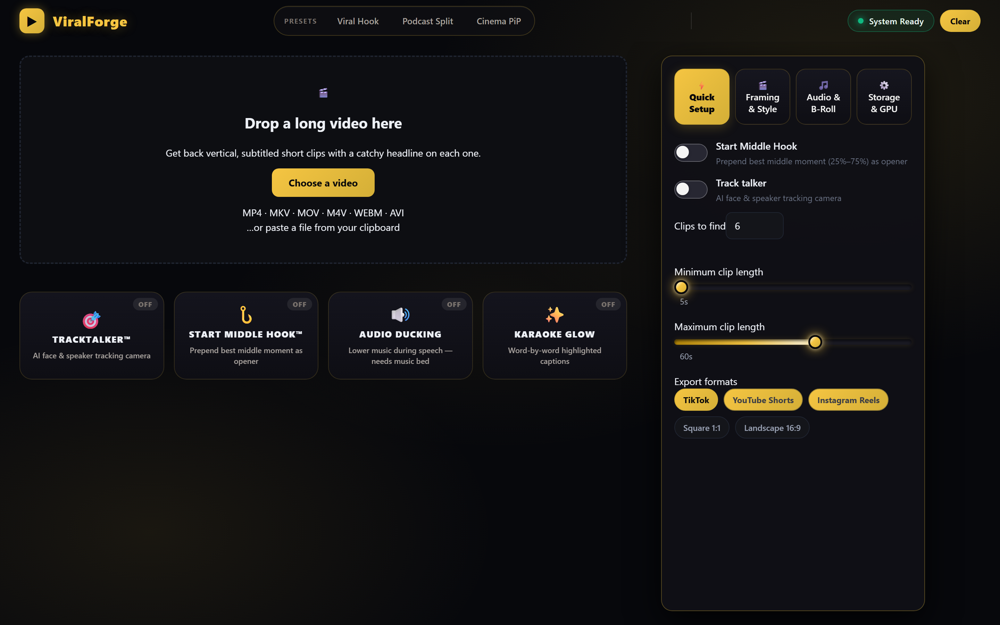

# ⚡ ViralForge v1.0.0

<div align="center">

## Local AI-Powered Long-to-Short Video Studio

[](#)
[-111111?style=for-the-badge&logo=windows&logoColor=D4AF37)](#)
[](#)
[-10B981?style=for-the-badge)](#)
[](#)

<br/>

**Turn one long video into vertical, subtitled, high-retention clips — without uploading anything.**

</div>

<div align="center">
  
</div>

## 📦 Download

1. Download **`ViralForge-Release.zip`**
2. Right-click → **Extract All…**
3. Double-click **`ViralForge.exe`**

> [!IMPORTANT]
> **Windows SmartScreen?** Click **More info** → **Run anyway**. This release is unsigned, which is expected for an independent open-source build. virustotal-scanned binaries are produced locally during the build.

> [!NOTE]
> The release `.zip` includes the local FFmpeg binaries and the bundled `faster-whisper-tiny` model, so the app works offline from first launch.

## ⚡ What's Included in v1.0.0

- **TrackTalker™** — YuNet ONNX speaker-aware face tracking for dead-center 9:16 crops
- **Start Middle Hook™** — automatically prepends the strongest climax as a cold open
- **Karaoke Glow** — active-word caption highlighting in vertical clips
- **Smart Audio Ducking** — ducks background music under speech (~−12 dB)
- **Full Inspector Modal** — edit captions, adjust start/end, Save & re-render in place
- **Layouts** — Center crop, Fit, Split, PIP, Manual crop
- **Export targets** — TikTok, YouTube Shorts, Instagram Reels, Square 1:1, Landscape 16:9
- **Encoder ladder** — NVENC → AMF → QSV → MediaFoundation → CPU `libx264`
- **CPU-friendly** — runs on PCs with no dedicated GPU
- **Ephemeral cache auto-purge** — running a new job wipes old unsaved workspaces
- **Portable paths** — defaults to `%USERPROFILE%\Videos\ViralForge`

## 🚀 Measured Performance

### 35-second 1080p clip (3 clips requested)

| Machine | Transcribe | Render (3× 9:16) | Total |
|---|---:|---:|---:|
| **CPU-only (`int8`, `libx264`)** | 2.17s | 10.11s | ~23s |
| **GPU (`float16`, `h264_nvenc`)** | 1.40s | 9.14s | ~20s |

### 180-second 1080p clip (3 clips)

| Machine | Transcribe | Render | Total |
|---|---:|---:|---:|
| **CPU-only** | 10.66s | 50.08s | **~107s** (~0.59 s per source second) |
| **GPU** | 3.60s | 46.39s | **~103s** (~0.57 s per source second) |

**Rule of thumb:** on modern hardware, CPU-only is usually only **3–10% slower** than the RTX-accelerated path because the bottleneck is face detection and the double-pass scrub — not the encoder.

## 📋 System Requirements

- **Windows 10/11 x64**
- **GPU optional** — NVIDIA / AMD / Intel or CPU
- **RAM** — 8 GB recommended (16 GB for `large-v3`)
- **Disk** — ~600 MB extracted + workspace temp during processing
- **Internet** — only for first-time large model downloads (not required for `tiny`)

## 🧹 Cache Policy

Unsaved job workspaces, uploads, previews and temp renders are wiped when you press **Clear** or start a new job. Saved exports in your output folder are never touched.

## 🛟 Troubleshooting

| Problem | Fix |
|---|---|
| SmartScreen blocks launch | **More info → Run anyway** |
| First launch is slow | The local venv is being prepared and verified once |
| “No speech detected” | Use a clip with audible speech, not just music |
| Preview looks stale | Close and reopen the editor, or re-render after edits |
| Output folder missing | Open `Storage & GPU` → **Open Folder** |

## 🛠️ Build from source

```bash
git clone https://github.com/<your-username>/ViralForge.git
cd ViralForge
python -m pip install -r requirements.txt
cd web && npm install && npm run build && cd ..
python -m clipforge --open
```

## 📜 Repository

Source: `ViralForge` on GitHub. Built as an independent, local-first alternative to cloud clipping services.

**Enjoy your first clip.**
